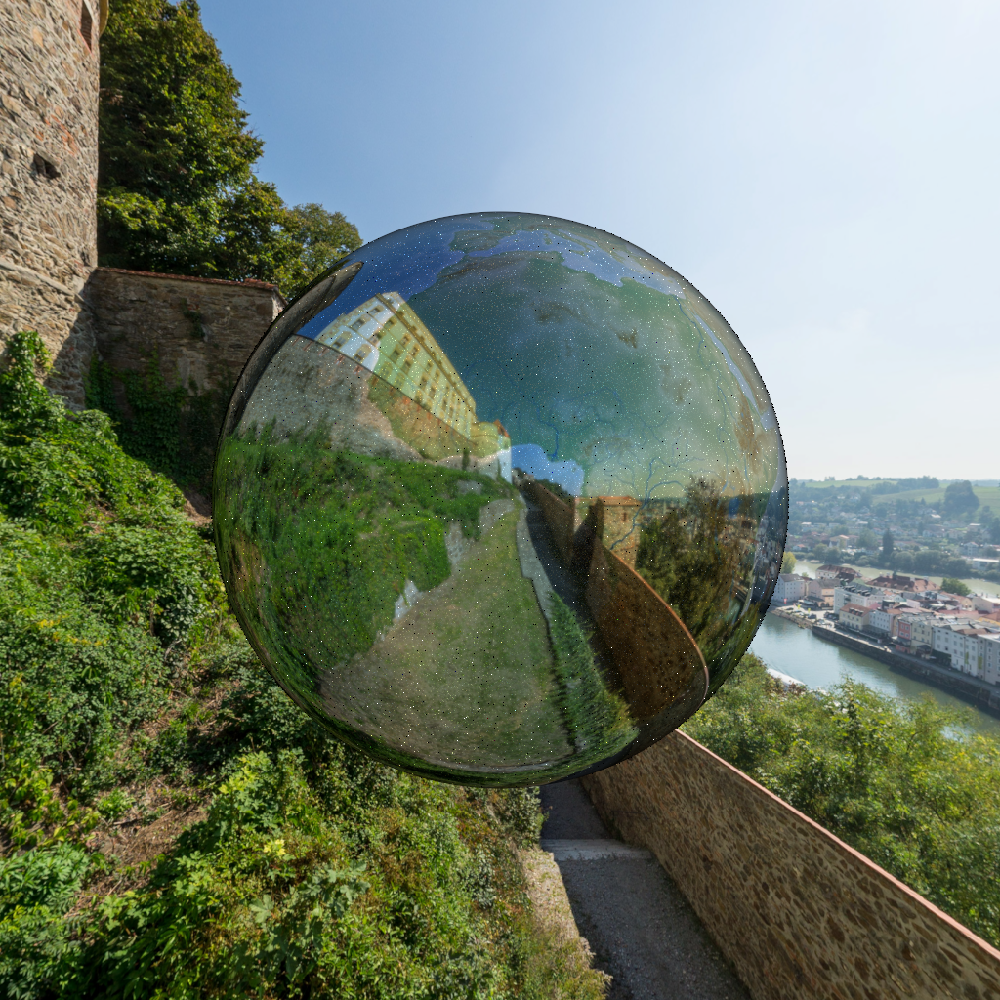
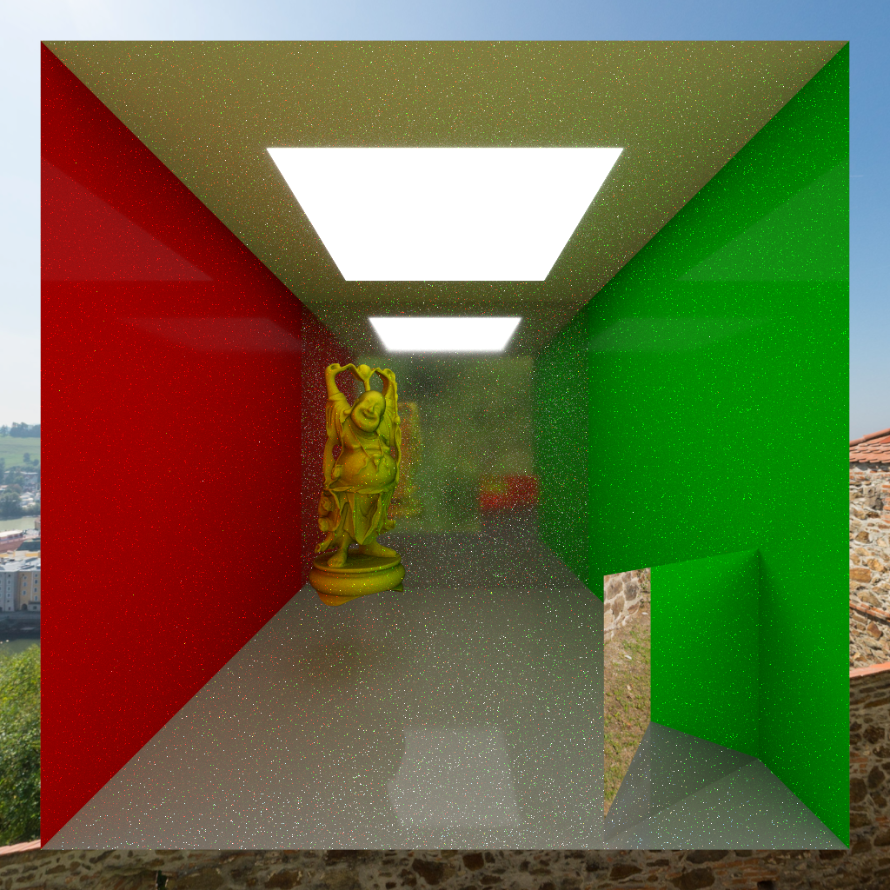
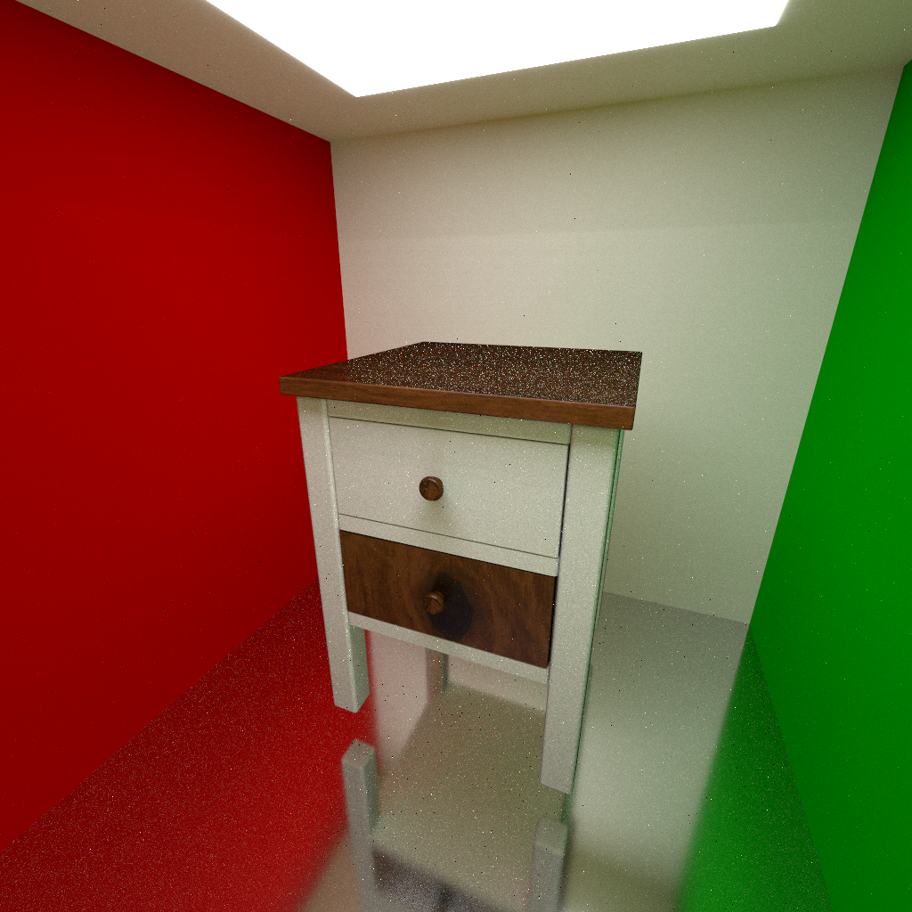

## demo





## 环境

在两套环境上作了测试

### Linux

- os: Ubuntu 20.04 x86_64
- cpu: Intel(R) Xeon(R) Gold 6148 CPU @ 2.40GHz, 2核
- 工具链: gcc 10.3.0

项目使用了C++17 STL库的并行算法, 在linux上需要安装tbb库:

```bash
sudo apt install libtbb-dev
```

构建时会链接到此库

### Windows

- os: Windows 10 x64
- cpu: Intel(R) Core(TM) i5-8265U CPU @ 1.60GHz, 4核
- 工具链: Visual Studio 2019, 16.11.16

经测试, Windows上不需要额外安装依赖

## 构建

项目使用 [xmake](https://xmake.io) 构建. 在 `xmake.lua` 文件所在目录下执行:

```bash
xmake f -m release  # 使用release模式编译
xmake -w            # 构建可执行文件
```

即可.
生成的二进制文件应该位于 `build` 文件夹下

也可以使用 CMake (>= 3.16) 构建, 与 xmake 并存:

```bash
cmake -B build-cmake                 # 配置, 默认为 Release 模式
cmake --build build-cmake --parallel # 构建可执行文件
```

生成的二进制文件为 `build-cmake/rt`. Windows 下使用 Visual Studio 等多配置生成器时,
需要指定配置: `cmake --build build-cmake --config Release`, 二进制位于 `build-cmake/Release/rt.exe`.
Linux 下会链接 tbb, 同样需要先安装 `libtbb-dev`.

## 运行

传入场景配置文件运行: `rt <scene-path> <image-dir>`, 其中路径是相对于可执行文件的, 例如

```bash
# 假设可执行文件位于build下
mkdir images  # 存放图片的文件夹
cd build
./rt.exe ../scene.obj.toml ../images
```

注意场景配置文件中的纹理图片路径和模型文件路径都是相对于配置文件的, 不是相对可执行文件的

也可以在其他位置运行可执行文件, 注意文件路径即可
